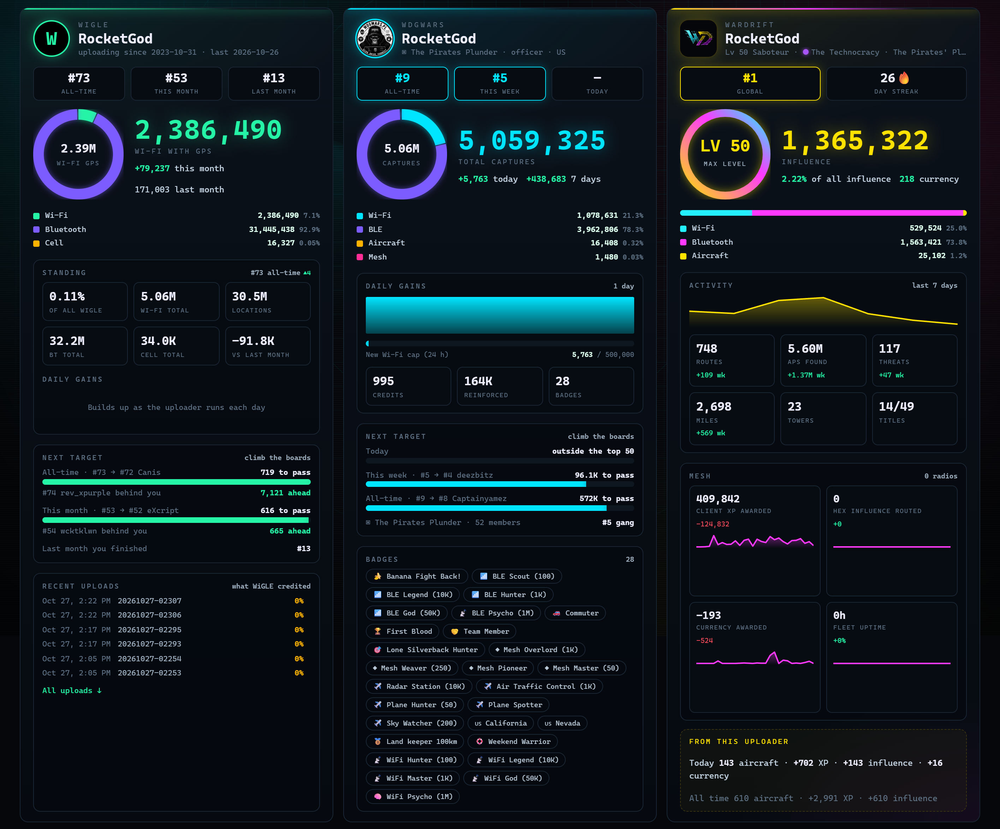

# Wardrive Uploader

Windows tray app that turns a PC into a wardriving rig. It collects Wi-Fi, Bluetooth, aircraft and LoRa mesh nodes from whatever is plugged in and uploads them to [WiGLE](https://wigle.net), [WDGWars](https://wdgwars.pl) and [Wardrift](https://wardrift.net), with a local dashboard, map, leaderboards and handshake cracking through [wpa-sec](https://wpa-sec.stanev.org).

## 📡 Description

It runs in the tray, finds the hardware you plug in and uses it. No setup per device and no checkboxes to turn things on. Every piece of hardware shows up on the dashboard with its own switch if you want it off.

- **Wi-Fi** from every adapter in the PC, plus monitor mode on USB adapters with drivers ported from the Wardrive Go Android app: MediaTek MT7612U (Alfa AWUS036ACM, Panda PAU0D) and Atheros AR9271. Monitor mode hops every 2.4 and 5 GHz channel.
- **Bluetooth** from the PC's Bluetooth radio.
- **Handshakes and PMKIDs** captured passively in monitor mode, saved as hashcat 22000 lines and sent to wpa-sec seconds after capture. Each capture shows its progress on wpa-sec and the password once it is cracked.
- **Location** from any source there is: a USB or Bluetooth GPS, your phone, or Windows location. The most accurate fix wins and every row records its accuracy.
- **Phone GPS with no app.** Click the Phone GPS tile, scan the QR code and the phone streams its location to the PC from its browser. GPS apps that send NMEA work too.
- **ADS-B** from an [RTL-SDR](https://www.rtl-sdr.com/) decoded on the PC by [dump1090](https://github.com/gvanem/Dump1090), or from a [PortaPack running Mayhem](https://github.com/portapack-mayhem/mayhem-firmware), which decodes on the device.
- **Mesh** from [Meshtastic](https://meshtastic.org/) and [MeshCore](https://meshcore.co.uk/) radios at the same time, over serial or BLE, read from the live packet stream.
- **Uploads** to every site you add a key for. WiGLE gets every row as WigleWifi CSV, WDGWars gets each network's latest sighting and Wardrift gets the last 72 hours.
- **Accounts and leaderboards** for WiGLE, WDGWars and Wardrift side by side, with your rank, the players around you and your upload history on each.
- **Updates**: checks for a new release on start and every 6 hours. One click downloads it, verifies the checksum and installs it.

## 🛠️ Notes

- Monitor-mode adapters and the RTL-SDR have to be on the WinUSB driver. [Zadig](https://zadig.akeo.ie/) does that in a few clicks. Normal Wi-Fi adapters keep their own driver.
- Phone GPS uses ports 10110 (NMEA) and 10111 (the phone page). The installer opens them to your local network only. The phone page uses a certificate the PC makes for itself, so the phone warns once before it opens.
- wpa-sec takes any key, so a mistyped key uploads into an account you can't see. The dashboard warns when nothing you sent shows up under your key.
- A radio's firmware caps how many mesh nodes it remembers. The capture store is unbounded and survives restarts, so the count keeps climbing past that.
- The bundled dump1090 takes the receiver position and tuner gain from its own `dump1090.cfg`. Left alone it ships `homepos = -1,-1`, which puts single-frame positions off the coast of West Africa.
- The map is [OpenFreeMap](https://openfreemap.org/). Aircraft details come from [adsbdb](https://www.adsbdb.com/) and photos from [Planespotters](https://www.planespotters.net/).
- Keys and the Wardrift sign-in session live in `%APPDATA%\WardriveUploader\config.json`. They are never returned by the dashboard API or written to the log. The Wardrift password is never stored.
- Adapter firmware ships with its own licenses, see [NOTICE](wdgwars_uploader/wardrive/firmware/NOTICE.md).

## 📦 Requirements

Windows and something to collect with: the PC's own Wi-Fi and Bluetooth are enough to start. Grab the MSI from [Releases](https://github.com/RocketGod-git/wardrive-uploader/releases/latest), or run from source with Python 3.11+. Add a key for any of [WiGLE](https://wigle.net/account), [WDGWars](https://wdgwars.pl/profile), [Wardrift](https://wardrift.net) and [wpa-sec](https://wpa-sec.stanev.org/?get_key).

On the road? [Wardrive Go](https://play.google.com/store/apps/details?id=com.rocketgod.wardrive) does all of this on Android and [iPhone](https://apps.apple.com/app/id6783390938).

## 🤝 Community

Join **The Pirates' Plunder** on Discord:

➡️ **[https://discord.gg/thepirates](https://discord.gg/thepirates)**

## 📄 License

[LICENSE](LICENSE)

