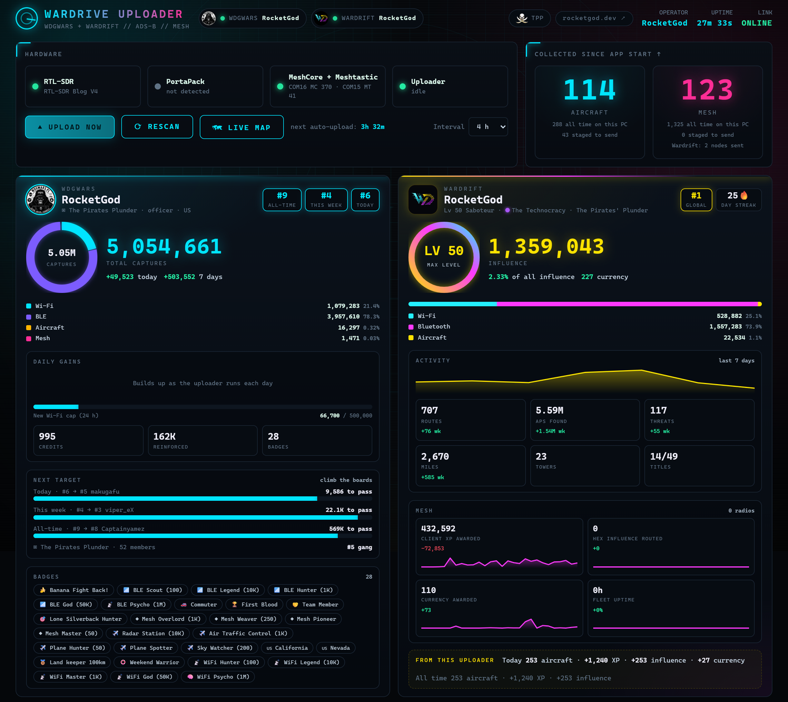
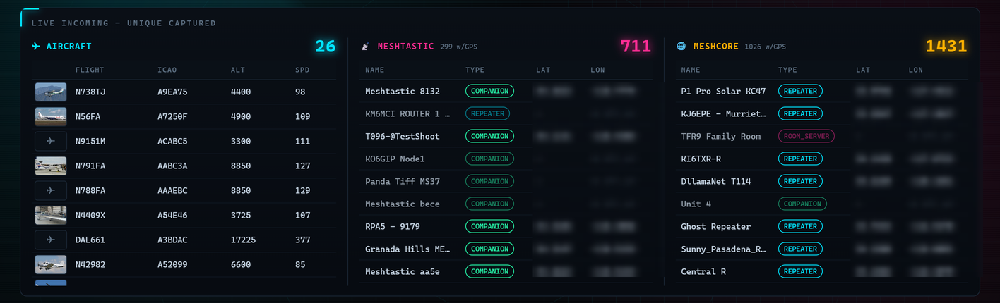
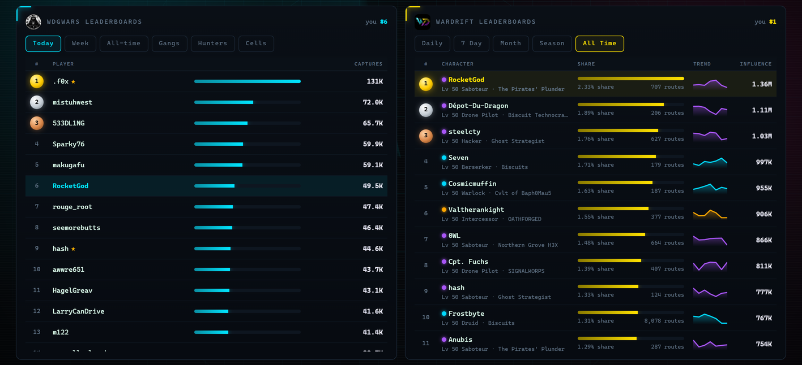
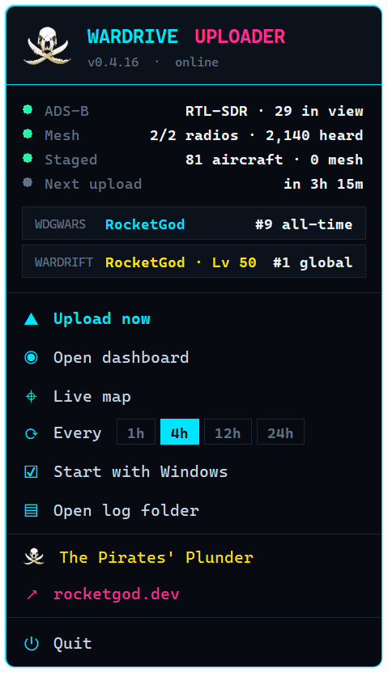
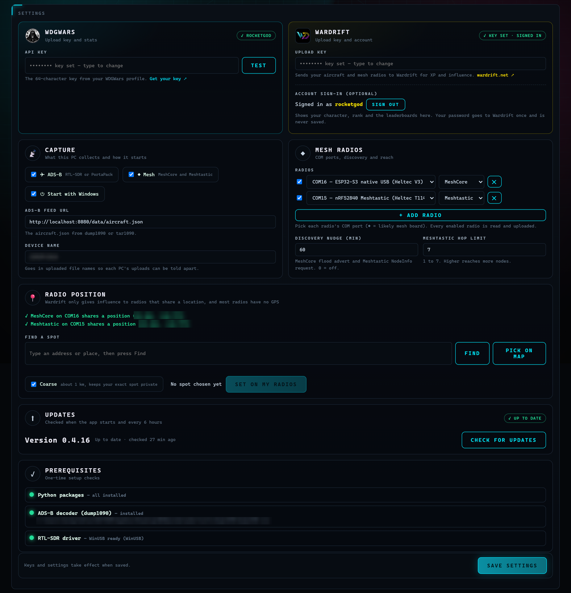

# Wardrive Uploader

Windows tray app that feeds live aircraft and LoRa mesh nodes to [WDGWars](https://wdgwars.pl) and [Wardrift](https://wardrift.net), with a local dashboard, map and leaderboards.

## 📡 Description

It runs in the tray, watches whatever radios are plugged in, and uploads on a schedule. Everything it hears is kept in its own store, so nodes and aircraft that the radio has already forgotten still make it into the next upload.

- **ADS-B** from an [RTL-SDR](https://www.rtl-sdr.com/) decoded on the PC by [dump1090](https://github.com/gvanem/Dump1090), or from a [PortaPack running Mayhem](https://github.com/portapack-mayhem/mayhem-firmware), which decodes on-device and hands the log back over its USB console.
- **Mesh** from [Meshtastic](https://meshtastic.org/) and [MeshCore](https://meshcore.co.uk/) radios at the same time, over serial or BLE, read from the live packet stream rather than from the node list.
- **Wardrift** (optional): aircraft and mesh nodes can also be sent to [Wardrift](https://wardrift.net) with a character API key, along with the battery, uptime and packet counters of each connected mesh radio. Signing in shows your character, rank and the Wardrift leaderboards.
- **Dashboard** on loopback: live feed, counters, a map, stats and leaderboards for both games, and the prerequisite checks.
- **Radio position**: set a fixed spot for radios without GPS, by address or on the map, exact or coarse.
- **Tray menu** with live status, ranks and quick actions.
- **Updates**: checks for a new release on start and every 6 hours. One click downloads it, verifies the checksum and installs it.

## 🛠️ Notes

- The RTL-SDR has to be on the WinUSB driver before any decoder can open it — that is what [Zadig](https://zadig.akeo.ie/) is for.
- A radio's firmware caps how many nodes it will remember (80 on a Meshtastic nRF52 build, around 350 on MeshCore) and evicts the rest. The capture store is unbounded and survives restarts, so the count keeps climbing past that.
- The bundled dump1090 build takes the receiver position and tuner gain from its own `dump1090.cfg`, not the command line. Left alone it ships `homepos = -1,-1`, which puts every single-frame position off the coast of West Africa.
- The map is [OpenFreeMap](https://openfreemap.org/) — no key, no tile account.
- Aircraft details come from [adsbdb](https://www.adsbdb.com/) and photos from [Planespotters](https://www.planespotters.net/).
- The API keys and the Wardrift sign-in session live in `%APPDATA%\WDGWarsUploader\config.json`; they are never returned by the dashboard API or written to the log. The Wardrift password is never stored.

## 📦 Requirements

Windows and at least one radio. Grab the MSI from [Releases](https://github.com/RocketGod-git/wardrive-uploader/releases/latest), or run from source with Python 3.11+. An API key from your [WDGWars profile](https://wdgwars.pl/profile) or a [Wardrift](https://wardrift.net) key is what the uploads are credited to.

## 🤝 Community

Join **The Pirates' Plunder** on Discord:

➡️ **[https://discord.gg/thepirates](https://discord.gg/thepirates)**

## 📄 License

[LICENSE](LICENSE)

